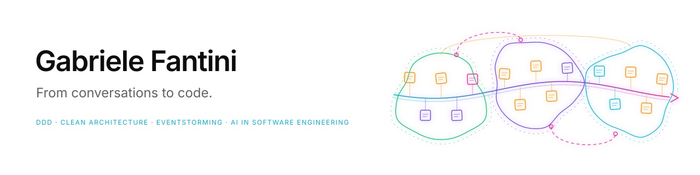

<picture>
  <source media="(prefers-color-scheme: dark)" srcset="./banner-dark.svg">
  
</picture>

### Hi, I'm Gabriele 👋

I'm a software engineer who starts from the domain. I turn conversations with domain experts into models, models into clean architecture, and architecture into code — increasingly with AI in the loop.

#### 🧭 How I work

- **Collaborative modelling** — domain storytelling and EventStorming to find the real problem before writing code.
- **Domain-driven design** — ubiquitous language, bounded contexts and aggregates that speak the language of the business.
- **Clean architecture** — explicit boundaries, ports and adapters, and a framework-independent core that stays testable.
- **Solid engineering** — testing, CI and reliable delivery. Both my theses were about shipping software you can trust.

#### 🧪 Exploring now

- **AI × Modelling** — turning EventStorming output into a first draft of bounded contexts and aggregates.
- **AI × Engineering** — coding agents in the development loop, guided by architecture, tests and conventions.
- **AI × Data** — governed context for agents: ontologies and metadata exposed through MCP instead of guesswork.

#### 🔗 Where software craft meets data

Lately I've been applying DDD thinking to data: ubiquitous language → **ontologies**, bounded contexts → **federated domains**, ports & contracts → **data contracts**, CI → **computational governance**.

Currently a software engineer at [@blindata](https://github.com/blindata) and a contributor to [@opendatamesh-initiative](https://github.com/opendatamesh-initiative).

#### 📫 Elsewhere

🌍 [gabrielefantini.github.io](https://gabrielefantini.github.io) · 💼 [LinkedIn](https://www.linkedin.com/in/gabriele-fantini-3b9711130) · ✉️ [gabrielefantini97@gmail.com](mailto:gabrielefantini97@gmail.com)

🎓 Education

- **MSc, Computer Engineering** — Politecnico di Torino (2020–2022). Thesis: *Continuous integration for end-to-end testing of mobile applications*.
- **BSc, Computer & Electronic Engineering** — Università degli Studi di Perugia (2016–2020). Thesis on over-the-air (OTA) software updates for automotive applications.

